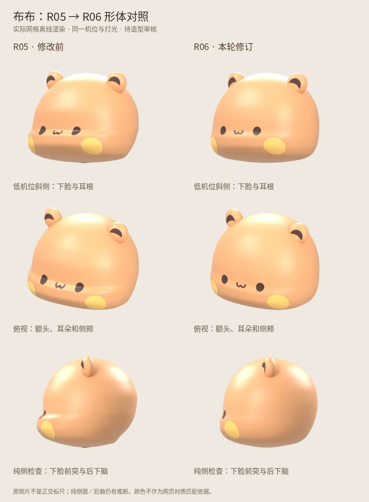
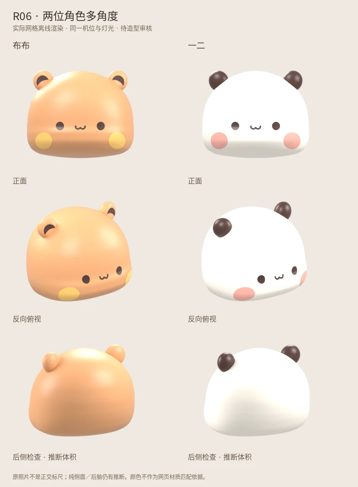

# R06 — 多视角头部修正（待造型审核）

本轮基于用户提供的五张公仔照片，修改 `character-volume.js` 的实际网格。R05 三维版本保留为同机位对照；已确认的二维 R05 / B 材质素材不改动。角色身份、W 形中性嘴及现有身体占位沿用，尚未宣称完成整套角色资产。

## 参考图怎样使用

| 照片 | 观察对象 | 可以约束什么 | 不能直接当成什么 |
|---|---|---|---|
| IMG_5507(2) | 拿相机布布、抱爱心一二 | 低机位下脸层次、前后体积、耳根遮挡 | 纯侧面或精确正交尺寸 |
| IMG_5509(2) | 骑坐两位角色 | 高机位头顶、两侧面、耳朵倾斜 | 站姿头身比 |
| IMG_5510(2) | 反向骑坐布布、一二 | 反方向眼距缩短、耳朵与侧颊关系 | 单张照片中的左右不对称造型 |
| IMG_5508(2) | 侧躺、仰躺与坐姿 | 姿态旋转后的下颌连续性、头身连接的观察提示 | 未遮挡完整后脑；没有据此拟合纯侧面 |
| IMG_5511(1) | 站姿、坐姿；含帽子造型 | 与另一机位交叉核对下脸和耳根 | 帽檐下被遮挡的头顶与耳朵 |

原始照片不放入公开仓库。五个观察机位覆盖两角色和正反转向。三个布布机位沿用 R04 的弱透视估计，两个一二机位为人工观察估计；不是重新标定的真实相机。旧版 landmark RMS 被移到 `historicalR04Fit`，不作为 R06 质量指标。侧背面是需要审核的推断体积。

## 形体预览





## 实际修改

- 下脸：缓和眼睛下方突然向前折出的台阶；嘴部以下仍浅浅前突，连续收回下巴，没有额外贴上嘴套。
- 侧颊：侧面中心独立于前后截面的平均值，调整前脸时不再连带拖动整圈太阳穴。
- 后脑：补足后下脑弧线，使上后脑到下颌的收拢更均匀；后脑仍缺少直接参考。
- 耳朵：布布采用浅凹耳面与弯曲月牙色块，耳根嵌入头顶；增加外倾以改善斜视方向。一二保留实心深色耳朵。
- 网格：头顶、下巴各用一个极点，移除旧版塌缩三角面；左右三角剖分镜像一致。头部基础网格为闭合、法线朝外的 9,122 顶点 / 18,240 三角面。
- 审核页：R05 / R06 同机位五组对照；保留两角色六视图。灰模隐藏贴面五官以专看体块，耳厚尺寸从实际参数读取。

## 复现与验证

```sh
npm ci
npm run test:geometry
npm run build
node tools/sync-pages.mjs
npx playwright test
```

几何检查验证有限坐标、封闭边、定向、非退化三角面、左右对称、下脸前突与下巴收拢。它不替代美术审核。

CPU 形体渲染从实际 Three.js 网格导出，不重新手工搭建另一套模型：

```sh
node tools/sculpt/export-heads.mjs test-results/sculpt
blender -b -t 4 --python tools/sculpt/render-heads.py -- test-results/sculpt/current-bubu.json test-results/sculpt/bubu
```

离线渲染和网页使用不同灯光／渲染器，因此仅对比轮廓和体块，不用于证明颜色匹配。网页截图和交互由 GitHub Actions 检查。

## 尚未定稿

后脑纯侧面和背面的精确体积、耳凹深度及耳根位置仍需美术审核。躯干、手肩、站姿脚部沿用此前占位，并未冒充本轮已解决；参考照片里的持物、骑坐、侧躺需要另做姿态资产。下一轮应在头部通过后集中处理这些部位。
